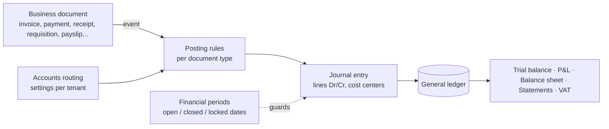

# Accounting engine (design)

Status: **design, not implemented yet**. It is the heart of the ERP: every module that moves money or stock posts through it. The rules come from studying a mature regional ERP (see [reference-rules.md](../domain/reference-rules.md)) and from standard double-entry accounting.

## Principles

1. **Double entry, always balanced.** Every posting is a journal entry whose lines satisfy Σ debit = Σ credit, validated before saving.
2. **Automatic postings.** Business documents (invoices, payments, stock movements, payroll, …) generate journal entries. Users never type the entries for routine operations.
3. **Immutable ledger.** Posted entries are never edited or deleted. The source document is changed through a correcting document (credit note, debit note, reversal), and the engine posts a reversal and a new entry. Generated entries are read-only in the UI.
4. **One transaction.** A document, its journal entries and its stock movements are written in the same MongoDB transaction (`withTransaction`).
5. **Traceability.** Each entry stores `source: { type, id, number }`, and each document links to its entries ("view entries" ⇄ "view source").
6. **Decimal math only.** Amounts are Decimal128 / decimal.js and rounded half-up to the currency's minor units **per line** ([ADR 0006](../adr/0006-money-as-decimal.md)).

## Building blocks

### Chart of accounts

- Tree with five roots: **Assets, Liabilities, Equity, Revenue, Expenses**. Codes are hierarchical and unique per tenant (for example `1` Assets › `12` Current assets › `1210` Inventory). Postings are allowed on **leaf accounts only**.
- Each tenant starts from a **Saudi template**.
- **Auto sub-accounts** are created for each client (receivables), supplier (payables), treasury or bank, warehouse (inventory), fixed asset, and tax (VAT collected "Income VAT" / VAT paid "Outcome VAT").

### Accounts routing

A per-tenant setting decides which account each kind of transaction posts to:

| Mode             | Meaning                                                                                     |
| ---------------- | ------------------------------------------------------------------------------------------- |
| Automatic        | Use the default (or auto-created sub-) account                                              |
| Specify per each | A specific account per client / product / category / document                               |
| Cancel           | Post nothing for this kind of transaction (for example no separate "discount allowed" line) |

Precedence for a line: line-level account → document-level account → routing default.

### Financial periods

- Exactly **one open period** at a time. Closing a period posts closing entries (P&L → Retained Earnings) and makes the period read-only.
- **Lock dates** ("closed periods") block back-dated changes without closing.
- Back-dated stock transactions trigger a **cost recalculation** from that date forward (a background job), never into closed periods.

## Posting rules (reference behavior)

`Dr` = debit, `Cr` = credit. All amounts are exclusive of tax unless stated otherwise.

| Event                                                                                                                    | Entry                                                                                                                                         |
| ------------------------------------------------------------------------------------------------------------------------ | --------------------------------------------------------------------------------------------------------------------------------------------- |
| Sales invoice issued                                                                                                     | Dr Client (total) / Cr Sales (net) / Cr VAT Income VAT (tax)                                                                                  |
| … cost of goods sold (on delivery: immediately, on requisition approval, or on the delivery date, depending on settings) | Dr Cost of Sales / Cr Inventory (warehouse), at moving-average cost                                                                           |
| Client payment (only when status = Completed)                                                                            | Dr Treasury/Bank / Cr Client                                                                                                                  |
| Credit note / refund receipt                                                                                             | Dr Sales Returns + Dr VAT / Cr Client; if goods come back: Dr Inventory / Cr Cost of Sales                                                    |
| Advance payment received (KSA)                                                                                           | Dr Treasury / Cr Customer Advances + Cr VAT; applied later to invoices                                                                        |
| Purchase invoice, goods received                                                                                         | Dr Inventory (warehouse) + Dr VAT paid / Cr Supplier                                                                                          |
| … with stock requisitions on                                                                                             | Dr Purchases / Cr Supplier, then on receipt Dr Inventory / Cr Purchases                                                                       |
| Purchase of a service / untracked item                                                                                   | Dr Cost of Sales (or expense account) / Cr Supplier                                                                                           |
| Purchase return / debit note                                                                                             | Dr Supplier / Cr Inventory (average cost) + Cr VAT paid                                                                                       |
| Supplier payment                                                                                                         | Dr Supplier / Cr Treasury/Bank                                                                                                                |
| Expense voucher                                                                                                          | Dr Expense (+ Dr VAT paid) / Cr Treasury/Bank                                                                                                 |
| Manual stock in / out                                                                                                    | Dr Inventory / Cr chosen account, or the reverse at average cost                                                                              |
| Stocktaking difference                                                                                                   | Dr/Cr Inventory against Cost of Sales (at average cost)                                                                                       |
| POS session (per-session mode)                                                                                           | Sales → Dr Staff Petty Cash / Cr Sales + VAT; on validation → Dr Treasury/Bank / Cr Staff Petty Cash; shortage → Dr Loss, overage → Cr Profit |
| Payroll approved                                                                                                         | Dr Salaries & Wages (earnings) / Cr deductions, Cr Advances (loan installments), Cr Accrued Wages (net)                                       |
| Payroll paid                                                                                                             | Dr Accrued Wages / Cr Treasury/Bank                                                                                                           |
| Employee loan disbursed                                                                                                  | Dr Employee Advances / Cr Treasury                                                                                                            |
| Depreciation                                                                                                             | Dr Depreciation Expense / Cr Accumulated Depreciation                                                                                         |
| VAT settlement (end of period)                                                                                           | Dr Income VAT / Cr Outcome VAT / Dr or Cr VAT Settlement (net payable)                                                                        |

## Inventory costing

- **Moving weighted average, one average per product across all warehouses**:
  `newAverage = (onHandValue + incomingValue) / (onHandQty + incomingQty)`.
  Outgoing movements (sales, transfers, stocktaking, returns to supplier) are valued at the average **on their date** and do not change it.
- Tax is never part of cost. Discounts and exchange rates are applied before averaging. Landed costs (freight, customs) can be allocated to a receipt by value, quantity or manually, and increase the average.
- **Watch out:** a zero-price receipt lowers the average and posts nothing. Validate or warn.

## Multi-currency

Documents store `currency`, `exchangeRate` and amounts in both the document currency and the tenant's base currency (SAR). Realized FX differences on settlement post to an FX gain/loss account. **Open question:** the exact accounts and the revaluation policy.

## Open design questions

Track these in issues before implementing:

- How an invoice-level discount is allocated across lines, and its rounding.
- Cheque lifecycle entries for each status (receivable and payable).
- Asset disposal gain/loss and write-off entries; straight-line pro-rating for the first period.
- Accounts for exchange-rate differences.
- Exact Dr/Cr for sales debit notes, advance settlements, insurance splits and loyalty redemptions.
- When COGS posts for invoice-linked requisitions (proposal: on requisition acceptance).
