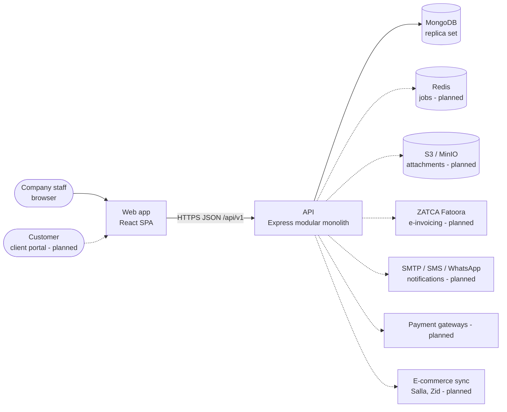
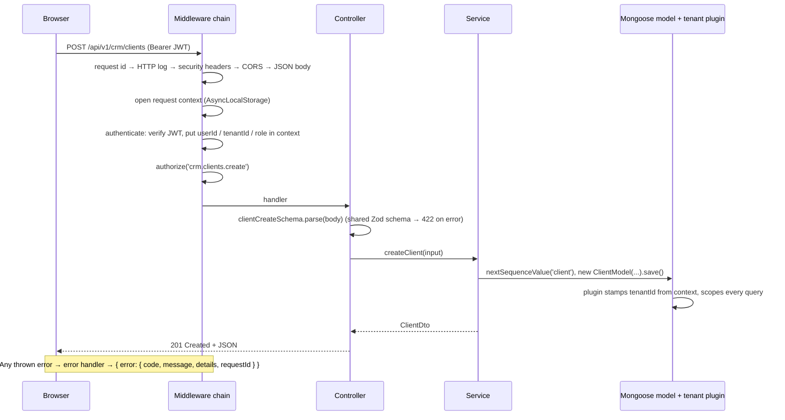

# Architecture overview

## What we are building

A multi-tenant SaaS ERP for Saudi small and medium businesses. One deployment serves many companies (**tenants**). Each tenant manages sales and invoicing, inventory, purchasing, accounting, rentals, HR and payroll. The product must comply with **ZATCA e-invoicing**, use the **Saudi VAT** rules and the **National Address** format, and work fully in **Arabic (RTL) and English**.

## System context



Solid lines exist today; dashed lines are planned.

## Architectural style: a modular monolith

The API is **one deployable process** split into **feature modules** (`apps/api/src/modules/<area>/<feature>`). Each module owns its models, services, routes and OpenAPI docs. We chose this over microservices ([ADR 0003](../adr/0003-express-modular-monolith.md)) because:

- We are a small team. One codebase, one deploy and one database keep us fast.
- ERP operations must be **atomic across modules**: posting an invoice writes sales, stock and journal entries in **one transaction**.
- Clear module boundaries keep the option to extract a module into a separate service later.

**Module boundary rule:** a module may call another module's **service functions**, but never its models directly. Cross-module side effects (for example "invoice issued → post journal entry") will go through an in-process event bus once the accounting module exists.

## Repository structure and dependency rules

```
apps/api  ──depends on──▶ packages/shared
apps/web  ──depends on──▶ packages/shared
packages/shared  ──▶ zod, decimal.js only (no React, no Express, no Mongoose)
```

- `apps/*` never import from each other. The web app talks to the API only over HTTP.
- `packages/shared` holds everything both sides must agree on: Zod schemas and DTO types, the permission catalog, currency constants, and money and VAT math. It is consumed as TypeScript source (an "internal package"); the API build bundles it.

## Request lifecycle (API)



## Cross-cutting concerns

| Concern          | How                                                                                  | Where                                                                                |
| ---------------- | ------------------------------------------------------------------------------------ | ------------------------------------------------------------------------------------ |
| Tenant isolation | `tenantId` on every tenant document, enforced by a Mongoose plugin that fails closed | `core/database/plugins/tenant-scope.plugin.ts`, [multi-tenancy.md](multi-tenancy.md) |
| Authentication   | Short-lived JWT (HS256, `jose`), argon2id passwords                                  | `core/security`, [security.md](security.md)                                          |
| Authorization    | Permission catalog + role mapping, route guard `authorize()`                         | `packages/shared/src/permissions`, `core/http/middleware/authorize.ts`               |
| Validation       | Shared Zod schemas, parsed in controllers (API) and in forms (web)                   | `packages/shared/src/schemas`                                                        |
| Errors           | `AppError` plus a central handler and a documented error envelope                    | `core/errors`, `core/http/middleware/error-handler.ts`                               |
| Request context  | AsyncLocalStorage: request id, tenant, user, role, locale                            | `core/context/request-context.ts`                                                    |
| Logging          | Pino JSON logs tagged with the request id; secrets redacted                          | `core/logger`                                                                        |
| Transactions     | `withTransaction()`; Mongoose joins the session automatically                        | `core/database/transaction.ts`                                                       |
| Numbering        | Atomic per-tenant sequences (C-000001)                                               | `core/numbering/sequence.ts`                                                         |
| Auditing         | `createdBy` / `updatedBy` plugin, timestamps                                         | `core/database/plugins/audit-fields.plugin.ts`                                       |
| Money            | Decimal strings in the API, Decimal128 in MongoDB, decimal.js in code                | [ADR 0006](../adr/0006-money-as-decimal.md)                                          |
| API docs         | OpenAPI 3.1 generated from the Zod schemas; Scalar UI                                | `core/openapi/registry.ts`, `/api/docs`                                              |
| i18n             | i18next (ar/en), Ant Design locale and direction, Zod locale                         | `apps/web/src/shared/i18n`                                                           |

## Status

| Area                                                                           | State                                                     |
| ------------------------------------------------------------------------------ | --------------------------------------------------------- |
| Monorepo, tooling, CI, Docker Compose                                          | ✅ in place                                               |
| API core (config, logging, errors, context, tenancy, auth, OpenAPI, numbering) | ✅ in place, tested                                       |
| Reference module: CRM → Clients (API + UI)                                     | ✅ in place, tested                                       |
| Web shell (RTL/LTR, routing, auth pages, layout, permissions)                  | ✅ in place, tested                                       |
| Business modules (sales, inventory, accounting, …)                             | 📋 planned: [module catalog](../domain/module-catalog.md) |
| Refresh tokens, background jobs, file storage, ZATCA integration               | 📋 planned                                                |
